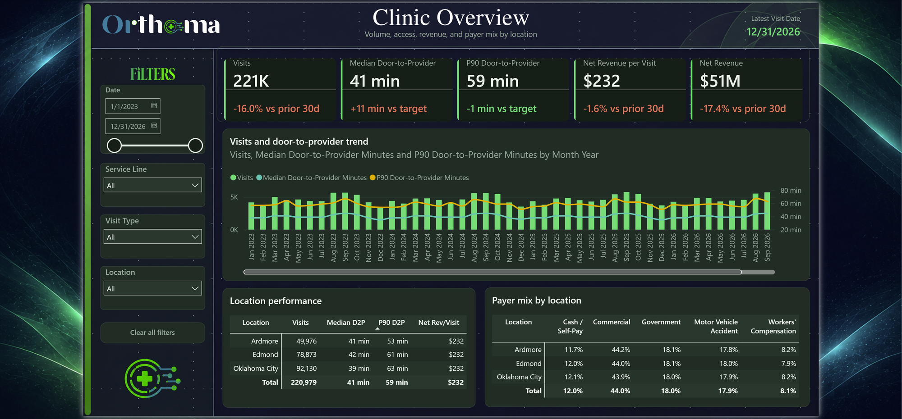
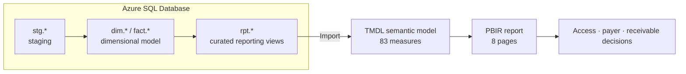
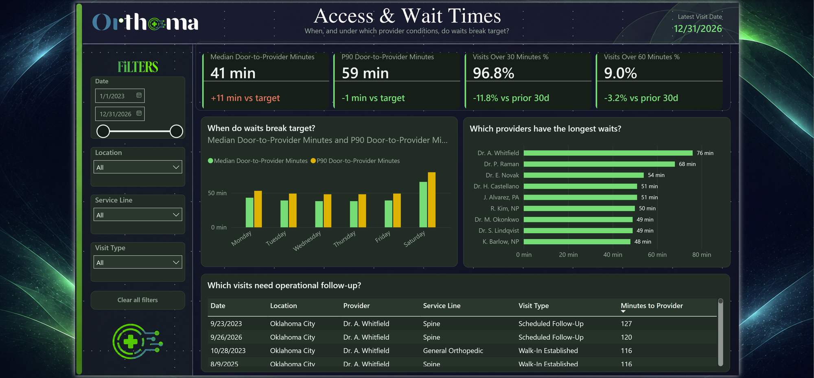
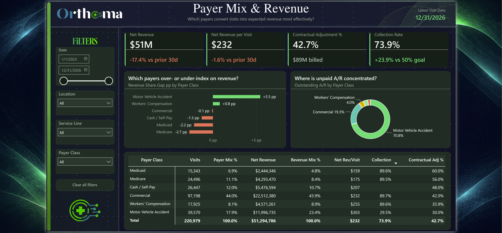
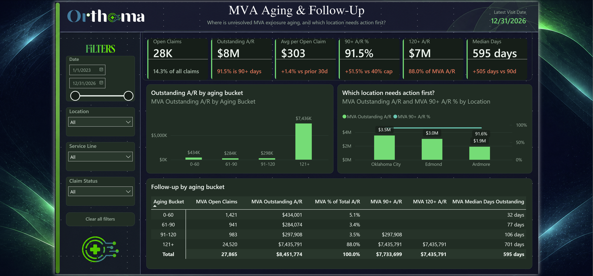
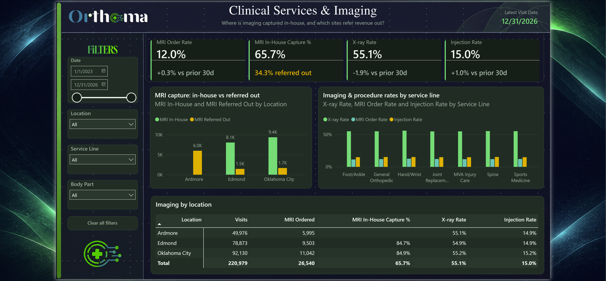
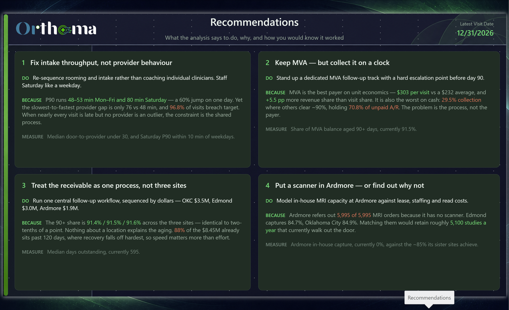

# Orthoma — Clinic Operations & Revenue Analytics

**A source-controlled Power BI solution for a three-site orthopedic walk-in practice — from an Azure SQL warehouse, through a TMDL semantic model, to an eight-page executive report.**



> All data is synthetic. Every figure below is computed by the model in this repository — none of it is illustrative.

---

## The problem

A walk-in orthopedic practice competes on access. If a patient waits too long they leave, and the visit, the imaging and the downstream procedure leave with them. But access is only half the story: two clinics can see identical volume and convert it into very different revenue depending on payer mix and how well claims actually collect.

Leaders needed one place to answer five connected questions:

1. Are access, demand and revenue moving in the right direction across locations?
2. When — and under which provider conditions — do waits break target?
3. Which payers convert visits into revenue most effectively?
4. Where is unresolved motor-vehicle-accident receivable exposure aging, and which site needs action first?
5. Where is imaging captured in-house, and which sites refer revenue out?

---

## At a glance

| | |
|---|---|
| **Domain** | Orthopedic clinic operations and revenue-cycle analytics |
| **Warehouse** | Azure SQL — staging → dimensional model → curated `rpt.*` reporting views |
| **Semantic model** | TMDL · 12 tables · 85 columns · **83 DAX measures** · 15 relationships |
| **Report** | PBIR · 6 analysis pages + 2 drillthrough pages · 1280 × 720 dark executive theme |
| **Scale** | 220,979 visits · ~194K claims · 3 locations · 9 providers · data through 31 Dec 2026 |
| **Source control** | PBIP / PBIR / TMDL — every visual, measure and relationship reviewable as text |

---

## Architecture



The warehouse is a real deliverable, not a diagram. `database/Orthoma.Database` holds the schemas, 13 tables, 12 views and the stored procedures that generate and load the synthetic data — scripted as-deployed, one object per file.

Power BI binds **only** to the `rpt.*` view layer. Renaming a physical column or reshaping a fact table doesn't break the report, because the views absorb the change.

---

## The report

| Page | Question it answers |
|---|---|
| **Clinic Overview** | Are access, demand and revenue moving in the right direction? |
| **Access & Wait Times** | When, and under which provider conditions, do waits break target? |
| **Payer Mix & Revenue** | Which payers convert visits into expected revenue most effectively? |
| **MVA Aging & Follow-Up** | Where is unresolved MVA exposure aging, and which location needs action first? |
| **Clinical Services & Imaging** | Where is imaging captured in-house, and which sites refer revenue out? |
| **Recommendations** | What to do about it — action, evidence and success metric |
| **Visit Details** *(drillthrough)* | 23-column visit-level detail, export-ready |
| **Claim Details** *(drillthrough)* | 14-column claim-level detail, export-ready |



---

## Findings

Every finding below is visible in the report.

### Access is broadly late, not occasionally catastrophic

Median door-to-provider is **41 minutes** against a 30-minute target; P90 is **59 minutes**. **96.8%** of eligible visits exceed 30 minutes, but only **9.0%** exceed 60. That is a whole distribution shifted right, not a long tail — which points at rooming and scheduling capacity rather than a handful of bad days.

Provider spread is narrow: **76 minutes** at the slowest, **48** at the fastest. With P90 clustered that tightly, individual provider behaviour isn't the lever. Throughput design is.

### Motor Vehicle Accident is the revenue story — in both directions

MVA is **17.9%** of visits but **23.4%** of net revenue, a **+5.5 pp** positive share gap and the highest net revenue per visit of any payer at **$303** against a **$232** book average.

It is also where the cash is stuck. MVA collects at **29.5%** where every commercial and government payer collects near **90%**, and it holds **70.8%** of all unpaid A/R.



### The MVA receivable is old, and uniformly so

Of **$8.45M** outstanding across **27,865** open claims, **88%** sits in the **121+ day** bucket and **91.5%** is 90+ days. Median days outstanding is **595**.

Split by site: Oklahoma City **$3.5M**, Edmond **$3.0M**, Ardmore **$1.9M** — but the 90+ share is essentially identical everywhere (**91.4% / 91.5% / 91.6%**). The aging profile is uniform, so this is a process problem, not a site problem. Prioritise by dollars, not by which clinic looks worst.



### Ardmore refers 100% of its MRI volume out

In-house MRI capture is **65.7%** overall — but the average hides the finding. Edmond captures **84.7%**, Oklahoma City **84.9%**. Ardmore captures **none**: all **5,995** of its MRI orders go to an outside provider, because the site has no scanner.

That is a concrete, quantified capital question — the kind a volume-only dashboard never surfaces.



---

## What to do about it

Findings are only worth the decisions they change. Each recommendation below names the action, the number that justifies it, and how you would know it worked — and they ship **inside the report**, not just in this readme.



### 1. Fix intake throughput, not provider behaviour

**Do:** Re-sequence rooming and intake rather than coaching individual clinicians. Staff Saturday like a weekday.

**Because:** P90 runs **48–53 minutes Monday to Friday and 80 minutes on Saturday** — a 60% jump on one day. Meanwhile the gap between the slowest and fastest provider is only 76 vs 48 minutes, and 96.8% of all visits breach the 30-minute target. When nearly every visit is late but no provider is an outlier, the constraint is the process every patient passes through, not the person they eventually see.

**Measure:** Median door-to-provider back under 30, and Saturday P90 within 10 minutes of the weekday figure.

### 2. Keep MVA — but collect it on a clock

**Do:** Stand up a dedicated MVA follow-up track with a hard escalation point before day 90.

**Because:** MVA is the **best** payer on unit economics — **$303** net revenue per visit against a $232 book average, and **+5.5 pp** more revenue share than visit share. It is also the worst on cash: **29.5%** collection where every other payer clears ~90%, and **70.8%** of all unpaid A/R. Dropping MVA would remove the most profitable visit in the practice. The problem is the collection process, not the payer.

**Measure:** Share of MVA balance aged 90+ days, currently **91.5%**. That single number tells you whether the escalation is working.

### 3. Treat the receivable as one process, not three sites

**Do:** Run one central follow-up workflow. Sequence the work by dollars — Oklahoma City **$3.5M**, Edmond **$3.0M**, Ardmore **$1.9M**.

**Because:** The 90+ share is **91.4% / 91.5% / 91.6%** across the three locations. Identical to within two-tenths of a point. Nothing about a site explains the aging, so site-specific interventions would be effort spent on noise. **$8.45M** is outstanding and **88%** of it already sits past 120 days, where recovery rates fall off hardest — so speed matters more than volume of effort.

**Measure:** Median days outstanding, currently **595**.

### 4. Put a scanner in Ardmore — or find out why not

**Do:** Model in-house MRI capacity at Ardmore against lease, staffing and read costs.

**Because:** Ardmore refers out **5,995 of 5,995** MRI orders because it has no scanner. Edmond captures **84.7%** and Oklahoma City **84.9%**. Matching its sister sites would retain roughly **5,100 studies a year** that currently walk out the door — along with the follow-up visit that often accompanies them.

**Measure:** Ardmore in-house capture rate, currently **0%**, against the ~85% the other sites already achieve.

> **On honesty:** these are directional recommendations grounded in the model. Turning them into a business case needs cost inputs this dataset does not contain — imaging lease and read costs, collections staffing, the true value of a retained referral. The analysis says where to look and how much is at stake; it does not claim to have priced the answer.

---

## How the model is built

### Two facts that deliberately do not touch

`Visits` and `Claims` are separate fact tables with **no relationship between them**. They conform only through shared dimensions — Date, Location, Payer Class.

This is intentional. A visit and a claim are different grains, and a claim can exist without a matching visit row in scope. Wiring them together would let someone drop `Aging Bucket` onto a visit-grain visual and get a number that looks plausible and is wrong.

The cost of that decision is real, and handled explicitly: because claim-grain fields cannot filter visit-grain visuals, the report ships **two** drillthrough pages rather than one. Claim-side visuals drill to **Claim Details**, visit-side visuals to **Visit Details**.

### Measures that answer the question actually asked

- **Median and P90 door-to-provider** use `MEDIANX` / `PERCENTILEX.INC` over an eligibility-filtered visit set, so nulls and non-clinical visits never dilute the statistic.
- **Period-over-period deltas** anchor to the last date with real activity rather than today, then compare a trailing 30 days against the prior 30 — so a blank tail in the calendar can't silently flatten a trend.
- **Unresolved A/R** is an Open-or-Denied claim calculation, and is never described as a cash ledger balance.
- **Mature-cohort collection** avoids judging claims too young to have been paid.

### Report engineering

- KPI strips are single multi-value card visuals using **native reference labels**, each bound to its own delta measure and coloured by a three-state DAX colour measure through true conditional formatting — not overlaid text boxes.
- Conditional colour is semantic: green favourable, coral unfavourable, amber caution, grey flat — with direction preserved per metric, so "lower is better" measures invert correctly.
- Dual-grain drillthrough, hidden target pages, a registered dark theme, display folders, sort-by columns and format strings throughout.

---

## Repository

```
power-bi/            PBIP · PBIR report definition · TMDL semantic model
database/            Azure SQL project — schemas, tables, views, procedures, build scripts
docs/reference/      Data dictionary — 8 sheets, field-level lineage
assets/              Theme, backgrounds, header artwork
artifacts/           Report page captures
```

### Data dictionary

`docs/reference/orthoma-portfolio-data-dictionary.xlsx` documents **every** column and measure: business definition, data type, key role, source object and column, sensitivity, and the report pages each measure feeds. It is generated by parsing the TMDL, so it cannot drift from the model.

The **Source to Report Map** resolves each measure through its DAX — following measure-to-measure references — down to the physical SQL columns it ultimately reads.

---

## Exploring it yourself

1. Build the warehouse. Run `database/Orthoma.Database/Build/` in order (`00_` → `04_`), then `Post-Deployment/10_generate_and_load.sql` to generate and load the synthetic data.
2. Open `power-bi/Orthoma.pbip` in Power BI Desktop.
3. Set the connection. The model reads the `rpt.*` schema through two Power Query parameters — no hard-coded server anywhere in the repository:

   | Parameter | Default | Set to |
   |---|---|---|
   | `SqlServer` | `your-server.database.windows.net` | your Azure SQL host |
   | `SqlDatabase` | `ortho` | your database name |

   **Home → Transform data → Edit parameters**, then refresh.

Prefer to look rather than build? PBIR and TMDL are plain text — every visual, measure and relationship is readable straight from the repo without opening Power BI at all.

---

## Governance

- All data is synthetic. No real patient, provider or payer information exists in this repository. Not PHI.
- Allowed revenue, claim-level paid amount and unresolved A/R are kept distinct and separately defined.
- Business rules, grain and known limitations are documented per field in the data dictionary.
- **No credentials or server names are committed.** The connection is parameterised; the reporting principal authenticates through Microsoft Entra ID.

### Least-privilege reporting access

The report does not connect as an owner. `database/Orthoma.Database/Security/pbi_report.User.sql` creates a dedicated read-only principal whose entire permission set is one line:

```sql
CREATE USER [pbi_report] WITH PASSWORD = N'<replace-me>';
GRANT SELECT ON SCHEMA::[rpt] TO [pbi_report];
```

A new database user starts with no permissions, so that single `GRANT` is the whole story — no rights on `stg`, `dim`, `fact` or `etl`. The report still works because every schema is `dbo`-owned, so **ownership chaining** lets the `rpt.*` views read their base tables without the caller holding any permission on them.

That makes the curated view layer the security boundary as well as the contract boundary: the report reads exactly what it was designed to read, and nothing else. The script ships a verification block that proves it — `rpt.FactVisit` returns rows under `EXECUTE AS USER`, `fact.Visit` and `stg.Visits` fail.

The model also defines **row-level security** — three roles filtering `Location`, so a site manager sees only their own clinic.

## Limitations

- Refresh requires the Azure SQL warehouse. `database/Orthoma.Database` builds it from scratch, including the synthetic data generator, so the project is reproducible end to end.
- Collection and aging figures are current-state claim calculations, not a transaction ledger.
- No production deployment, row-level security or scheduled refresh is claimed.

---

*Built with Power BI Desktop, Azure SQL and TMDL. DAX measure development and final assembly were done with AI assistance.*
